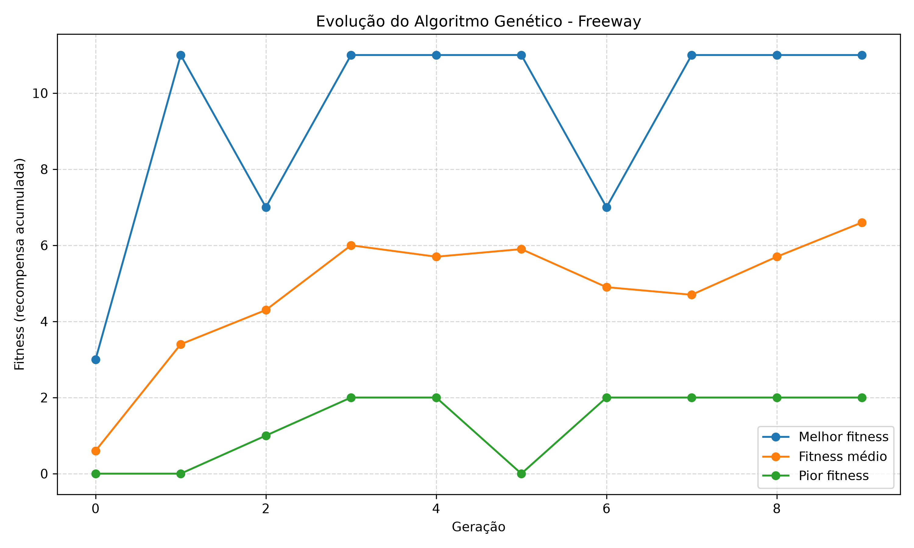
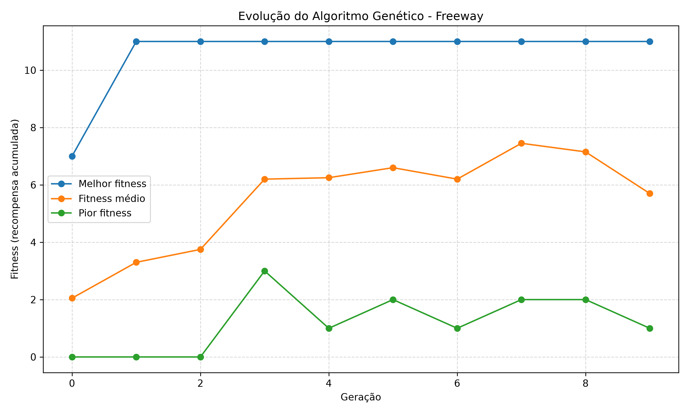
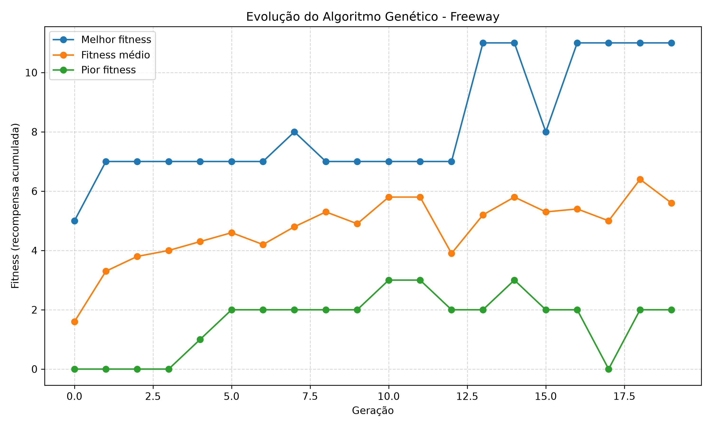

# Algoritmo Genético aplicado ao Atari Breakout

## 1. Descrição do projeto

Este projeto utiliza um **algoritmo genético** para otimizar uma rede neural simples capaz de tomar decisões no jogo Atari Breakout. O objetivo é evoluir agentes por meio de seleção, elitismo e mutação, buscando aumentar a recompensa obtida durante as partidas.

O ambiente é executado por meio da biblioteca Gymnasium, utilizando o ALE (Arcade Learning Environment).

---

## 2. Tecnologias utilizadas

- Python
- NumPy
- Gymnasium
- ALE-Py
- Matplotlib

---

## 3. Estrutura do projeto

```text
disciplinaIA/
├── main.py
├── requirements.txt
└── resultados/
    ├── gerar_grafico.py
    ├── historico.csv
    └── grafico_evolucao.png
```

### Arquivos

- `main.py`: executa o algoritmo genético e salva os resultados de cada geração.
- `resultados/gerar_grafico.py`: gera os gráficos de evolução.
- `resultados/historico.csv`: armazena os dados de fitness.
- `resultados/grafico_evolucao.png`: gráfico gerado a partir dos resultados.

---

## 4. Configuração dos experimentos

### Ambiente utilizado e forma de observação

O ambiente utilizado foi:

```text
ALE/Breakout-v5
```

A observação foi realizada através da **memória RAM** do jogo, composta por 128 posições.

Cada posição da RAM representa informações internas do ambiente, como posição da bola, da raquete e estado geral da partida.

### Rede neural

A rede neural utilizada possui:

| Componente | Valor |
|------------|-------|
| Entradas | 128 |
| Camada oculta | 16 neurônios |
| Saídas | 4 ações |

Os valores de entrada são normalizados para o intervalo entre 0 e 1.

A camada oculta utiliza a função de ativação `tanh`.

A saída escolhida pelo agente corresponde ao neurônio com maior valor de ativação (`argmax`).

### Fitness

O fitness é definido como a soma das recompensas obtidas durante uma partida.

Quanto maior o fitness, melhor o desempenho do agente.

---

## 5. Funcionamento do algoritmo genético

O algoritmo segue as etapas abaixo:

1. Inicialização da população.
2. Avaliação dos agentes.
3. Seleção dos indivíduos mais aptos.
4. Preservação dos melhores indivíduos (elitismo).
5. Reprodução por cópia dos pais selecionados.
6. Aplicação de mutação.
7. Formação da nova geração.

O ciclo é repetido até atingir o número definido de gerações.

### Estratégia de seleção

A população é ordenada de acordo com o fitness.

Os **50% melhores indivíduos** são selecionados para formar o conjunto de pais da próxima geração.

### Elitismo

Os melhores indivíduos encontrados são preservados sem alteração.

```python
NUM_ELITE = 2
```

Portanto, os **2 melhores agentes** passam diretamente para a geração seguinte.

### Mutação

A mutação é aplicada aos pesos e vieses da rede neural.

O processo ocorre através da adição de ruído gaussiano em parte dos parâmetros da rede.

---

# 6. Resultados dos experimentos

Foram realizados três experimentos independentes para avaliar o impacto da configuração do algoritmo genético sobre o processo evolutivo.

---

## Experimento 1

### Configuração

| Parâmetro | Valor |
|------------|-------|
| População | 10 |
| Gerações | 10 |
| Seleção | 50% melhores |
| Elitismo | 2 |
| Taxa de mutação | 0,10 |
| Intensidade da mutação | 0,20 |

### Resultados

| Geração | Melhor fitness | Fitness médio | Pior fitness |
|---------|---------------|--------------|--------------|
| 0 | 7,0 | 3,8 | 0,0 |
| 1 | 11,0 | 5,6 | 1,0 |
| 2 | 11,0 | 3,9 | 1,0 |
| 3 | 11,0 | 8,2 | 3,0 |
| 4 | 11,0 | 6,9 | 2,0 |
| 5 | 11,0 | 5,5 | 0,0 |
| 6 | 11,0 | 8,5 | 2,0 |
| 7 | 11,0 | 5,1 | 2,0 |
| 8 | 11,0 | 5,8 | 1,0 |
| 9 | 11,0 | 5,8 | 3,0 |

---

## Experimento 2

### Configuração

| Parâmetro | Valor |
|------------|-------|
| População | 10 |
| Gerações | 10 |
| Seleção | 50% melhores |
| Elitismo | 2 |
| Taxa de mutação | 0,02 |
| Intensidade da mutação | 0,10 |

### Resultados

| Geração | Melhor fitness | Fitness médio | Pior fitness |
|---------|---------------|--------------|--------------|
| 0 | 7,0 | 2,05 | 0,0 |
| 1 | 11,0 | 3,3 | 0,0 |
| 2 | 11,0 | 3,75 | 0,0 |
| 3 | 11,0 | 6,2 | 3,0 |
| 4 | 11,0 | 6,25 | 1,0 |
| 5 | 11,0 | 6,6 | 2,0 |
| 6 | 11,0 | 6,2 | 1,0 |
| 7 | 11,0 | 7,45 | 2,0 |
| 8 | 11,0 | 7,15 | 2,0 |
| 9 | 11,0 | 5,7 | 1,0 |

---

## Experimento 3

### Configuração

| Parâmetro | Valor |
|------------|-------|
| População | 30 |
| Gerações | 20 |
| Seleção | 50% melhores |
| Elitismo | 2 |
| Taxa de mutação | 0,10 |
| Intensidade da mutação | 0,20 |

### Resultados

| Geração | Melhor fitness | Fitness médio | Pior fitness |
|---------|---------------|--------------|--------------|
| 0 | 5,0 | 1,6 | 0,0 |
| 1 | 7,0 | 3,3 | 0,0 |
| 2 | 7,0 | 3,8 | 0,0 |
| 3 | 7,0 | 4,0 | 0,0 |
| 4 | 7,0 | 4,3 | 1,0 |
| 5 | 7,0 | 4,6 | 2,0 |
| 6 | 7,0 | 4,2 | 2,0 |
| 7 | 8,0 | 4,8 | 2,0 |
| 8 | 7,0 | 5,3 | 2,0 |
| 9 | 7,0 | 4,9 | 2,0 |
| 10 | 7,0 | 5,8 | 3,0 |
| 11 | 7,0 | 5,8 | 3,0 |
| 12 | 7,0 | 3,9 | 2,0 |
| 13 | 11,0 | 5,2 | 2,0 |
| 14 | 11,0 | 5,8 | 3,0 |
| 15 | 8,0 | 5,3 | 2,0 |
| 16 | 11,0 | 5,4 | 2,0 |
| 17 | 11,0 | 5,0 | 0,0 |
| 18 | 11,0 | 6,4 | 2,0 |
| 19 | 11,0 | 5,6 | 2,0 |

---

## 7. Gráficos

### Experimento 1



### Experimento 2



### Experimento 3



Os gráficos apresentam a evolução do melhor fitness e do fitness médio ao longo das gerações.

---

## 8. Comparação dos experimentos

| Experimento | População | Gerações | Taxa de mutação | Intensidade | Melhor fitness |
|------------|-----------|-----------|----------------|-------------|----------------|
| 1 | 10 | 10 | 0,10 | 0,20 | 11,0 |
| 2 | 10 | 10 | 0,02 | 0,10 | 11,0 |
| 3 | 30 | 20 | 0,10 | 0,20 | 11,0 |

Todos os experimentos encontraram indivíduos com fitness máximo igual a 11,0, porém apresentaram comportamentos evolutivos diferentes.

---

## 9. Análise sobre exploração e convergência

A exploração do espaço de busca é realizada por meio da mutação aplicada aos pesos e vieses das redes neurais. Quanto maior a taxa e a intensidade de mutação, maior a diversidade genética produzida na população.

No **Experimento 1**, o algoritmo encontrou rapidamente uma solução com fitness 11,0 já na geração 1. A partir desse ponto, o melhor fitness permaneceu constante, indicando convergência precoce. Apesar disso, o fitness médio continuou oscilando devido às mutações aplicadas aos descendentes.

No **Experimento 2**, a redução da taxa de mutação para 0,02 e da intensidade para 0,10 diminuiu a capacidade de exploração do algoritmo. Embora o melhor fitness também tenha alcançado 11,0 logo no início da execução, observou-se menor diversidade na população e uma evolução mais conservadora.

No **Experimento 3**, o aumento da população para 30 indivíduos e da quantidade de gerações para 20 permitiu uma exploração mais extensa do espaço de busca. O fitness máximo demorou mais para ser encontrado, surgindo apenas na geração 13, o que sugere maior diversidade genética e menor risco de convergência prematura.

De forma geral, os resultados indicam que:

- Populações maiores favorecem a exploração.
- Taxas de mutação menores reduzem a diversidade genética.
- O elitismo preserva as melhores soluções encontradas.
- O fitness máximo de 11,0 pode representar um ótimo lusão

O algoritmo genético foi capaz de evoluir agentes para o ambiente Atari Breakout utilizando apenas informações da memória RAM do jogo.

Os três experimentos demonstraram que a combinação de seleção, elitismo e mutação permite melhorar o desempenho dos agentes ao longo das gerações. O melhor resultado encontrado foi um fitness de 11,0.

Além disso, os experimentos mostraram que parâmetros como tamanho da população, taxa de mutação e número de gerações influenciam diretamente o equilíbrio entre exploração e convergência, impactando a velocidade e a qualidade da evolução dos agentes.

## 10. Como executar o projeto

### Pré-requisitos

* Python instalado.
* Git instalado, caso o projeto seja clonado do GitHub.

### Clonar o repositório

```bash
git clone https://github.com/Renanpacheco/disciplinaIA.git
cd disciplinaIA
```

### Criar e ativar o ambiente virtual

No Linux:

```bash
python3 -m venv .venv
source .venv/bin/activate
```

### Instalar as dependências

O projeto utiliza o arquivo `requirements.txt` para instalar as bibliotecas e suas versões registradas.

```bash
pip install -r requirements.txt
```

### Executar o algoritmo genético

Na raiz do projeto, execute:

```bash
python main.py
```

O programa executará o algoritmo genético e salvará os resultados das gerações no arquivo:

```text
resultados/historico.csv
```

### Gerar o gráfico dos resultados

Depois que a execução do algoritmo terminar, gere o gráfico com:

```bash
python resultados/gerar_grafico.py
```

O gráfico será salvo em:

```text
resultados/grafico_evolucao.png
```